<p align="center"></p>

# Bewässerungsplaner – Benutzerhandbuch

> ⚠️ **Stand 0.6.0: noch nicht mit echter Hardware getestet.** Alle Funktionen sind mit simulierten Ventilen und Sensoren erprobt (automatische Tests und eine simulierte Test-Instanz). Mit echten Ventilen, z. B. SONOFF über Zigbee2MQTT, ist die Erweiterung noch nicht gelaufen. Richte am Anfang **nur ein Ventil** ein, mach einen kurzen Testlauf und bleib dabei, bis du siehst, dass das Ventil wirklich selbst schließt.

Die Bilder stammen aus der simulierten Test-Instanz (Beispielgarten, kein echter Ort).

---

## Inhalt

1. [Installieren und einrichten](#1-installieren-und-einrichten)
2. [Ventile und Sensoren hinzufügen](#2-ventile-und-sensoren-hinzufügen)
3. [Zonen und Programme anlegen](#3-zonen-und-programme-anlegen)
4. [Der Plan](#4-der-plan)
5. [Wasser-Ansichten](#5-wasser-ansichten)
6. [Betrieb: was läuft, was kommt, wie war es](#6-betrieb-was-läuft-was-kommt-wie-war-es)
7. [Flächen und Zeitplan](#7-flächen-und-zeitplan)
8. [Die Dashboard-Karte](#8-die-dashboard-karte)
9. [Wie die Gießdauer berechnet wird](#9-wie-die-gießdauer-berechnet-wird)
10. [Überwachung und Alarme](#10-überwachung-und-alarme)
11. [Winterpause](#11-winterpause)
12. [Sicherheit: Was passiert, wenn etwas ausfällt?](#12-sicherheit-was-passiert-wenn-etwas-ausfällt)
13. [Automationen](#13-automationen)
14. [Häufige Fragen](#14-häufige-fragen)

---

## 1. Installieren und einrichten

Voraussetzung: **Home Assistant 2026.11 oder neuer**.

1. **Einstellungen → Marketplace**, dann ein eigenes Repository hinzufügen: als GitHub-Link `Kingsteam/FlowerPower` eintragen. (Beim ersten Mal fragt Home Assistant nach der Verbindung zu GitHub.)
2. **Bewässerungsplaner** herunterladen und Home Assistant neu starten.
3. **Einstellungen → Geräte & Dienste → Integration hinzufügen → Bewässerungsplaner.**
4. Im Dialog wählst du:
   - die **Wetterquelle** (eine Wetter-Entität, z. B. deine Wetterstation oder ein Wetterdienst). Ohne Wetterquelle (und ohne eigenen Temperaturfühler) rechnet die Erweiterung keine Verdunstung, dann bleibt nur die Dauer von Hand. Die Wetterquelle lässt sich später auf der Seite **Geräte** ändern.
   - das **Zeitfenster**, in dem gegossen werden darf (z. B. 4 bis 7 Uhr).

Danach gibt es in der Seitenleiste den Eintrag **Bewässerung** und in Home Assistant ein Gerät „Bewässerungsplaner“ mit Schaltern (Automatik, Winterpause), dem Regler **Wassersparen** und je Zone und Programm eigenen Geräten.

---

## 2. Ventile und Sensoren hinzufügen

Am einfachsten geht es im Panel: **Bewässerung → Geräte**. Dort stehen alle Ventile und Sensoren in einer Tabelle, mit Gerät, Treiber, Sicherheitsstufe, Zonen, Wasserversorgung, gelerntem Durchfluss und dem Zustand jetzt.

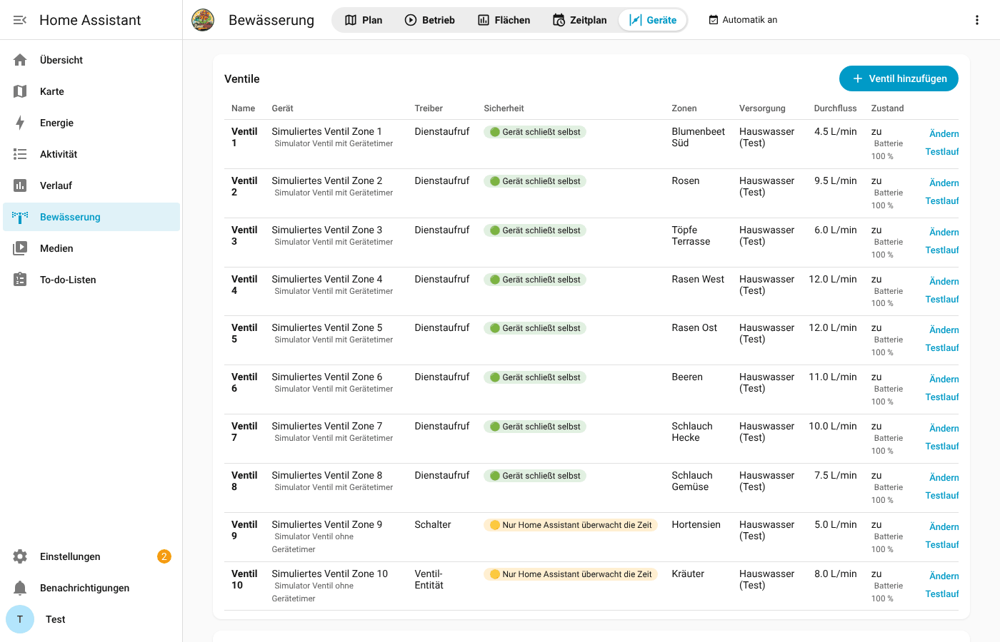

**Neues Ventil:**

1. **„Ventil hinzufügen“** und das **Gerät wählen** (Suchfeld für Name, Hersteller oder Raum). Angeboten werden alle Geräte mit einem Schalter oder Ventil. Geräte mit bekanntem Profil sind markiert.
2. Der Bewässerungsplaner **füllt alles selbst aus**: Name, Treiber, Geräteprofil und die Entitäten je Aufgabe (Schalten, Durchfluss, Menge, Gerätestatus, Batterie), bei Zigbee2MQTT auch den Namen in Zigbee2MQTT. Rechts siehst du den Wert jetzt, so erkennst du gleich, ob die Zuordnung stimmt. Für das **SONOFF SWV über Zigbee2MQTT** ist alles vorausgefüllt.
3. **Zuordnen:** Wasserversorgung (oder eine neue anlegen), vorhandene Zonen anklicken und auf Wunsch gleich eine **neue Zone** mit Gießdauer anlegen.
4. **„Ventil anlegen“.** Der Bewässerungsplaner prüft alles und lädt neu (dauert ein paar Sekunden; während gegossen wird, geht das nicht).
5. Danach wird der **Testlauf** angeboten (10 bis 60 Sekunden). Er startet **nur, wenn du auf „Jetzt testen“ drückst**: Das Ventil öffnet **wirklich**. Geprüft wird, ob es öffnet, wie viel fließt und ob es **von selbst schließt**. Das Ergebnis wird beim Ventil gespeichert.

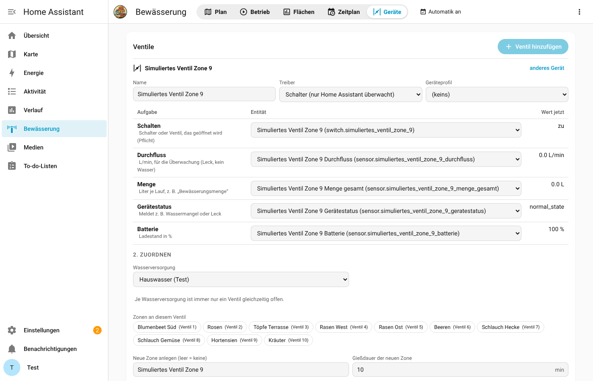

**Treiber:**

- **Zigbee2MQTT:** schickt `{"state":"ON","on_time":<Sekunden>}`. Die Dauer geht also mit, und das Ventil schließt selbst.
- **Schalter** oder **Ventil** aus Home Assistant
- **Dienstaufruf** für alles andere (z. B. ESPHome), mit `{duration}` im Befehl

**Sicherheitsstufe** (Spalte „Sicherheit“):

- 🟢 **Gerät schließt selbst:** Auch wenn Home Assistant oder das Funknetz ausfällt, geht das Ventil nach der Zeit zu.
- 🟡 **Nur Home Assistant überwacht die Zeit:** Das funktioniert, aber bei einem Ausfall kann das Ventil offen bleiben.

**Ändern und Löschen:** In der Zeile auf **„Ändern“**. Beim Löschen eines Ventils bleiben seine Zonen erhalten (ohne Ventil). Wo das Ventil auf dem Plan liegt und wie die Leitung läuft, zeichnest du auf der Seite **Plan**.

**Sensoren:** Unter der Ventil-Tabelle, mit **„Sensor hinzufügen“**:

- **Bodenfeuchte** ersetzt für ihre Zonen die Schätzung (dazu die Messwerte bei „voll“ und „leer“ eintragen).
- **Regenmenge** (mm) ohne Zonen gilt für den ganzen Garten.
- **Temperatur**, **Luftfeuchte** und **Wind**: eigene Fühler im Garten. Sie ersetzen die Werte der Wetter-Entität, für die Verdunstung und für „bei Frost/Wind überspringen“. Fällt ein Fühler aus, gilt wieder die Wetter-Entität. Je Art zählt der erste Fühler.

Bei der Auswahl der Entität stehen oben die, die zur Art passen (z. B. alle Temperaturen), jeweils mit dem Wert jetzt. Tippen sucht in Name und Entität, mehrere Wörter gehen auch („garten temp“). „Alle Entitäten anzeigen“ holt den Rest dazu.

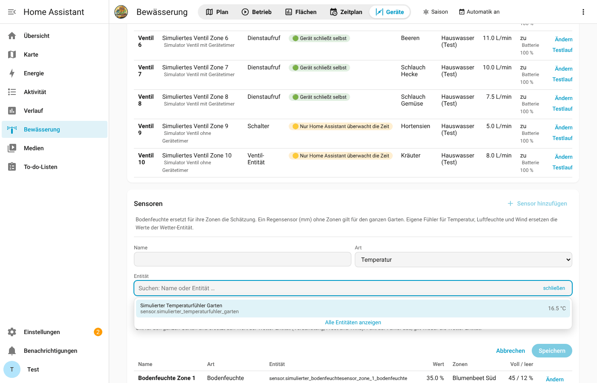

**Wetter, Zeitfenster und Saison:** Ganz unten auf der Seite **Geräte**. Dort stellst du ein:

- die **Wetter-Entität** (Wetterdienst oder Wetterstation, auch „keine“);
- das **Zeitfenster** zum Gießen;
- die **Winterpause nach Datum** (nur Tag und Monat).

Der Knopf **„Winterpause einschalten/beenden“** schaltet sofort um.

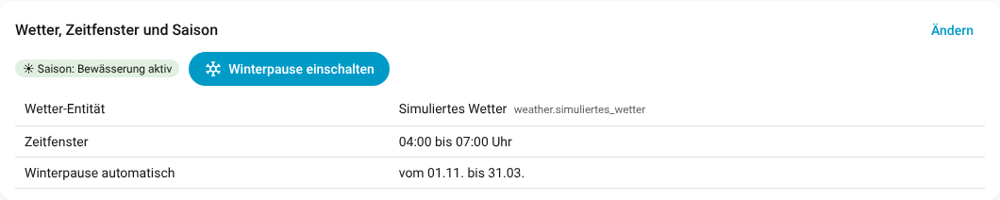

Dasselbe geht weiterhin auch über **Einstellungen → Geräte & Dienste → Bewässerungsplaner → Konfigurieren** (Assistent Schritt für Schritt).

> ⚠️ Für den Testlauf muss Wasser anliegen, und niemand soll im Sprühbereich stehen.

---

## 3. Zonen und Programme anlegen

Ebenfalls unter **Konfigurieren**:

- **Zonen:** Name, Ventil, Höchstdauer und die **Dauer-Art**:
  - **von Hand:** feste Dauer
  - **berechnet:** aus dem Wasserhaushalt (Kapitel 9)
  - **aus einer Entität**, z. B. Smart Irrigation
- **Wasserversorgungen:** welche Ventile an einer Leitung hängen und wie viele gleichzeitig offen sein dürfen (für die Hausleitung: **1**).
- **Programme:** welche Zonen in welcher Reihenfolge. Den Zeitplan stellst du am bequemsten im Panel ein (Kapitel 7).
- **Sensoren:** Bodenfeuchte (einer Zone zugeordnet) und Regensensor.

Neue Zonen und Programme erscheinen nach dem Speichern sofort; die Integration lädt dazu neu.

---

## 4. Der Plan

Seitenleiste → **Bewässerung** → **Plan**. Beim Öffnen passt der Plan dein Grundstück (die gezeichnete Grundstücksgrenze) mit etwas Rand ein.

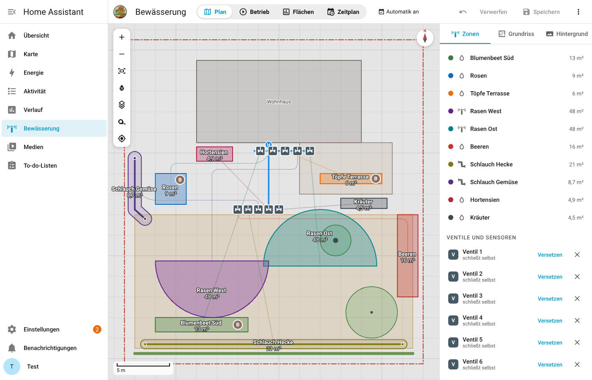

**Hintergrund** (Reiter rechts):
- **Luftbild** (basemap.at in mehreren Ansichten, OpenStreetMap, Esri) mit **Adresssuche** (Lupe) und **Orten** (Fadenkreuz; holt einmal deinen Standort aus dem Browser, geht nur über https)
- eigenes **Bild** mit Maßstab aus zwei Punkten, oder nur ein **Raster**
- Regler für die Sichtbarkeit des Luftbilds

**Grundriss** (Reiter Grundriss): Haus, Wege, Zaun, Hecke, **Grundstücksgrenze** (zeigt Fläche und Umfang), Bäume (mit Stammdicke), Wasserhahn, Bodenflächen und **Zuleitungen**. Mit dem **Schloss** sperrst du Formen, dann lassen sie sich im Plan nicht mehr versehentlich verschieben („Alle sperren“).

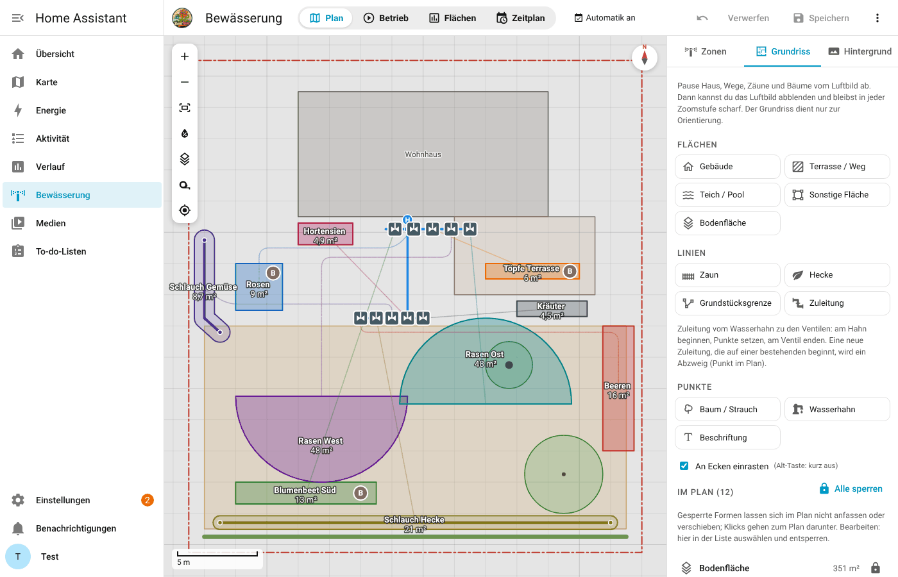

**Zuleitungen** vom Wasserhahn zu den Ventilen: am Hahn beginnen, Punkte setzen, am Ventil enden. Eine Zuleitung, die auf einer anderen beginnt, wird ein **Abzweig** (blauer Punkt). Verschiebst du Hahn, Ventil oder Abzweig, ziehen die Leitungen mit.

**Zonen zeichnen** (Reiter Zonen, Zone anklicken):

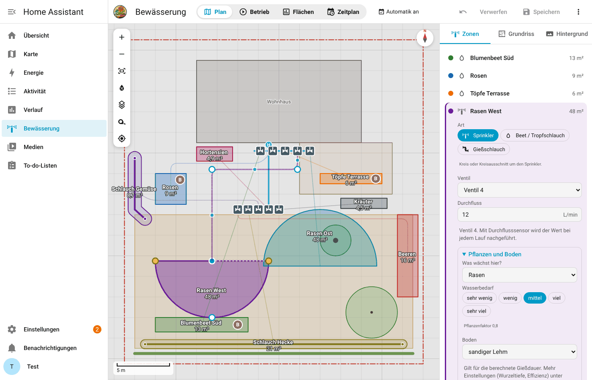

- **Art:**
  - **Sprinkler:** Mittelpunkt drücken und bis zum Rand ziehen; Anfasser für Reichweite und Bogen
  - **Beet / Tropfschlauch:** Ecken anklicken
  - **Gießschlauch:** eine Linie, dazu die Reichweite (Radius) links und rechts
- **Ventil** der Zone und dessen **Durchfluss** (L/min). Ohne Durchflusssensor trägst du ihn hier von Hand ein (z. B. Eimer auslitern), sonst fehlen Liter und Wasser-Ansichten.
- **Leitung zum Ventil:** die Linie im Plan anfassen und ziehen, dann entsteht ein Knick mit runder Ecke. Ein Doppelklick auf einen Knick löscht ihn.
- **Pflanzen und Boden:** was wächst (bestimmt den Pflanzenfaktor), Wasserbedarf in fünf Stufen, Bodenart
- **Jetzt gießen** bzw. **Gießen abbrechen**, solange die Zone läuft

**Speichern** übernimmt die Zeichnung. **Rückgängig** geht auch nach dem Speichern. Über das Menü ⋮ lässt sich der Plan als Datei **sichern** und wieder einspielen.

**Beim Gießen** sieht man im Plan, wie das Wasser vom Hahn durch die Zuleitung zum offenen Ventil (blau, Griff längs) und weiter zur Zone fließt. Sprinkler zeigen Wellen.

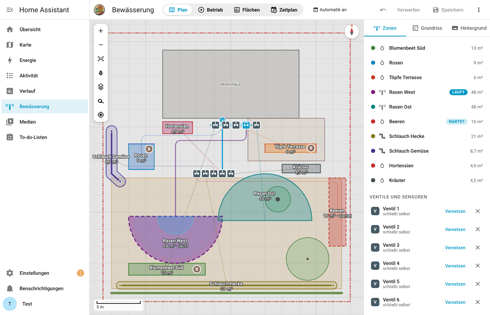

---

## 5. Wasser-Ansichten

Der **Tropfen-Knopf** links im Plan legt ein Kachelraster über das ganze Grundstück:

| Ansicht | zeigt |
|---|---|
| **Geplante Gießmenge** | wie viele Millimeter der nächste geplante Durchgang bringt (Überschneidungen zählen doppelt; hinter dicken Baumstämmen bleibt es beim Sprinkler trocken) |
| **Bodenfeuchte jetzt** | wie voll das Wasserkonto ist: trocken (braun) – halb – voll (blau) |
| **Bodenfeuchte nach dem Gießen** | dasselbe nach dem nächsten Gießen; violett heißt zu nass |

Graue Kacheln werden nicht bewässert. **Schraffierte** Kacheln haben keinen Wert; der Grund steht in der Legende (z. B. „Durchfluss unbekannt“).

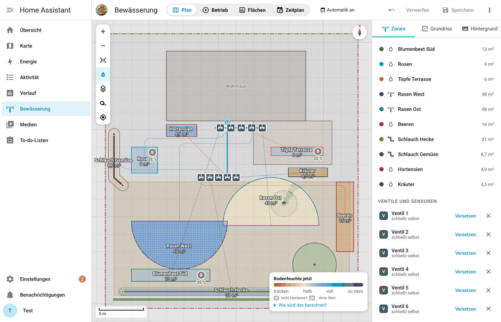

---

## 6. Betrieb: was läuft, was kommt, wie war es

Reiter **Betrieb**:

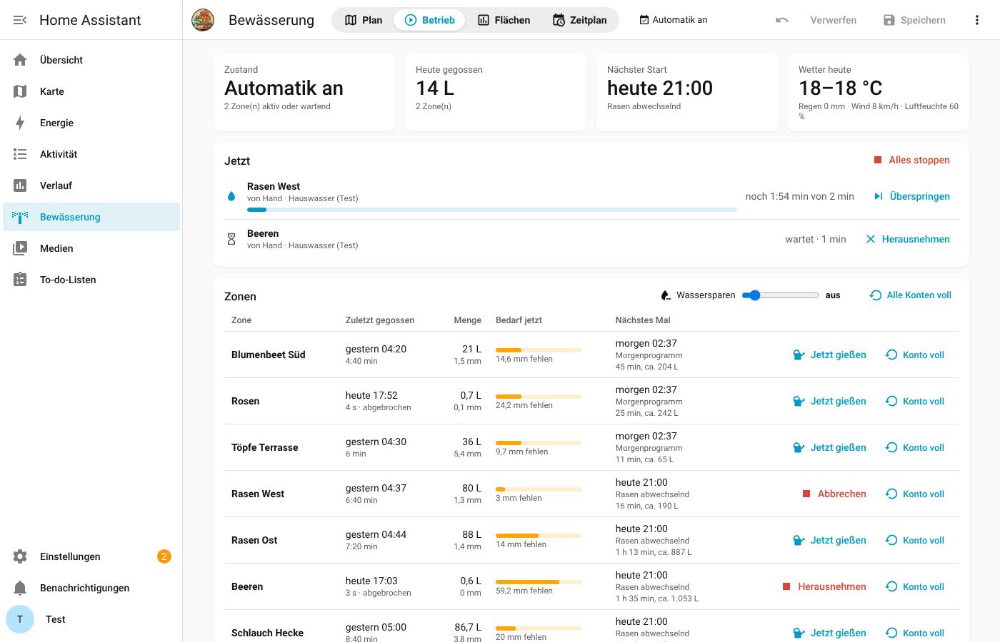

- **Jetzt:** was gießt (mit Restzeit) und was wartet.
  - **Überspringen:** schließt die laufende Zone, dann geht es mit der nächsten weiter.
  - **Herausnehmen:** streicht eine wartende Zone.
  - Dazu **Programm abbrechen** und **Alles stoppen**.
- **Zonen:** zuletzt gegossen (Dauer, Liter, mm), Bedarf jetzt, nächster Start mit geplanter Dauer und Litern.
- **Wassersparen** (0 bis 50 %): kürzt die geplante Gießdauer aller Zonen, z. B. bei Hitze oder Wasserknappheit.
- **Konto voll** je Zone bzw. **Alle Konten voll:** setzt den berechneten Bedarf auf 0, z. B. nachdem du von Hand gegossen hast.
- **Wetter und Wasserhaushalt:** Verdunstung und Regen der letzten 14 Tage, gegossene Liter je Tag, auch als Tabelle.
- **Verlauf:** jeder Lauf mit Litern (gemessen oder geschätzt) und mm, abgebrochene Läufe, übersprungene Programme und Alarme. Lässt sich nach Zone filtern.

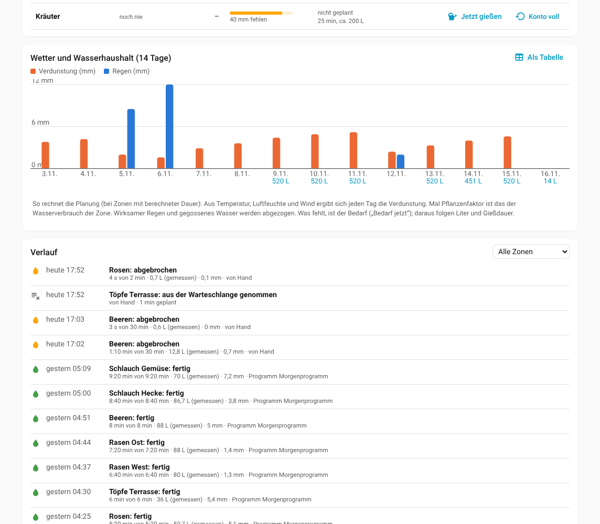

„Automatik an/aus“ oben in der Kopfzeile lässt sich anklicken und schaltet die Zeitpläne ein oder aus.

---

## 7. Flächen und Zeitplan

**Flächen:** bewässerte Fläche gesamt und je Art, Grundstück und bewässerter Anteil, Wasser pro Durchgang, Überschneidungen, Tabellen je Zone und Ventil.

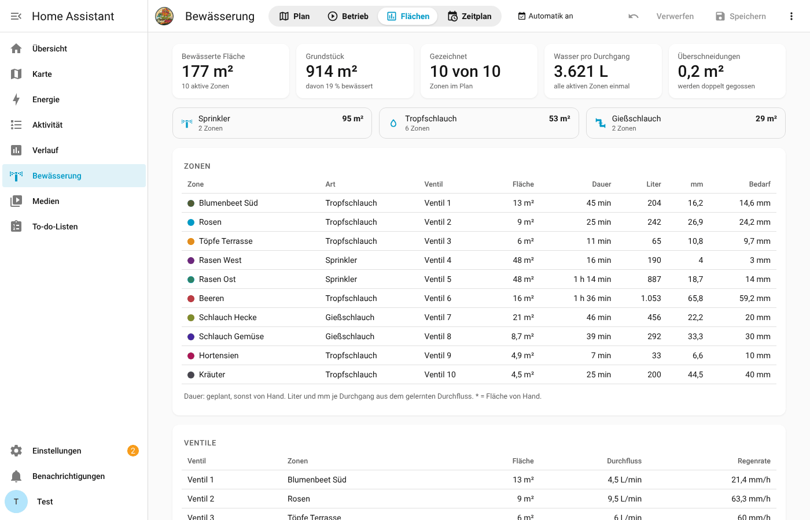

**Zeitplan:** die nächsten 7 Tage als Wochenansicht, je Programm eine Karte.

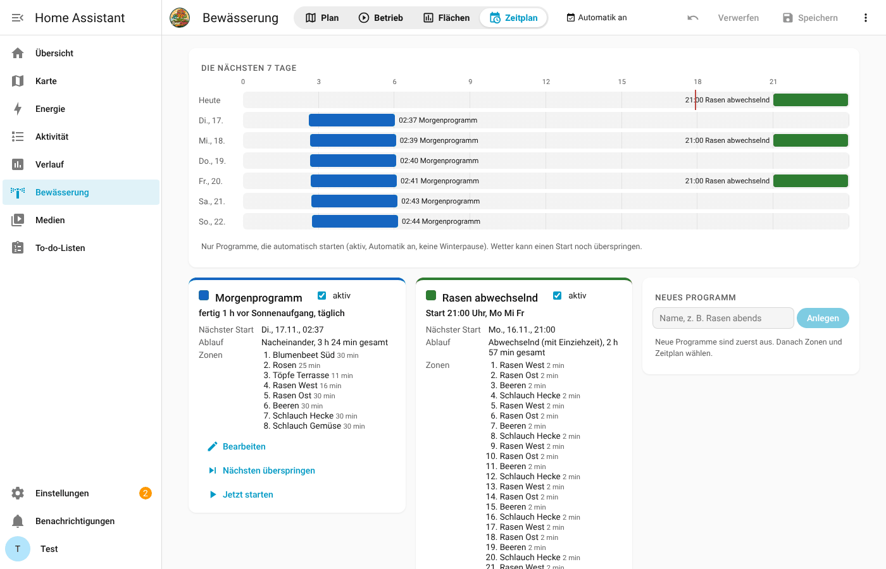

- **Start um** einer Uhrzeit oder **Fertig bis**, jeweils auch relativ zu **Sonnenaufgang/-untergang** (z. B. fertig 1 Stunde vor Sonnenaufgang)
- **Tage:** Wochentage oder alle N Tage
- **Ablauf:**
  - **Nacheinander**
  - **Abwechselnd** mit Einziehzeit (gut für Rasen)
  - **Nach Bedarf** (durstigste Zone zuerst)
- **Überspringen** bei Regen, Frost oder Wind; **Nächsten überspringen**; **Jetzt starten** (reiht nur ein)

---

## 8. Die Dashboard-Karte

Die Karte **„Bewässerung“** kannst du in jedes Dashboard legen (Dashboard bearbeiten → Karte hinzufügen → „Bewässerung“). Sie wird automatisch mitgeladen; du musst keine Ressource eintragen.

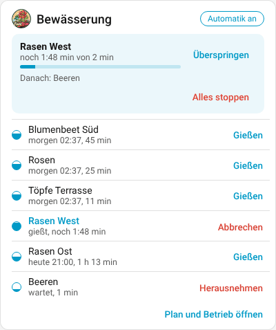

Sie zeigt Automatik und Wassersparen, was gerade gießt (mit **Überspringen** und **Alles stoppen**) und je Zone den nächsten Start, dazu **Gießen** oder **Abbrechen**. Der kleine Kreis vor jeder Zone zeigt, wie voll das Wasserkonto ist.

Einstellungen der Karte (alle freiwillig):

```yaml
type: custom:irrigation-planner-card
title: Bewässerung
zones: [zone_1, Rosen]   # nur diese Zonen (ID oder Name)
show_zones: true
```

---

## 9. Wie die Gießdauer berechnet wird

Gilt für Zonen mit der Dauer-Art „berechnet“. Gerechnet wird mit einem **Wasserkonto** je Zone (FAO-56, das Standardverfahren der Welternährungsorganisation):

1. **Verdunstung:** Jeden Tag wird aus Temperatur, Luftfeuchte und Wind deiner Wetterquelle (oder deiner eigenen Fühler) die Verdunstung (ET₀) berechnet. Fehlen Luftfeuchte oder Wind, gibt es eine einfachere Formel, die nur die Temperatur braucht.
2. **Pflanzenfaktor:** ET₀ × Pflanzenfaktor (z. B. Rasen 0,8) ist der Verbrauch der Zone. Er wird vom Konto abgezogen.
3. **Auffüllen:** Wirksamer Regen und Gießen füllen das Konto wieder auf.
4. **Kontogröße:** das Wasser, das der Boden im Wurzelraum halten kann. Es hängt von Bodenart und Wurzeltiefe ab.
5. **Bedarf:** Was im Konto fehlt, ist der Bedarf in mm. Ein **Bodenfeuchtesensor** ersetzt die Schätzung.
6. **Liter:** Bedarf × Fläche ÷ Wirkungsgrad (Tropfschlauch 90 %, Sprinkler 75 %), dann **Dauer** = Liter ÷ Durchfluss. Wassersparen kürzt am Ende um den eingestellten Anteil.

**Beispiel:** 12,6 m² Beet, Bedarf 3,8 mm → 3,8 × 12,6 ÷ 0,9 ≈ **53 L** → bei 4,5 L/min ≈ **12 min**.

---

## 10. Überwachung und Alarme

| Situation | wahrscheinliche Ursache | Reaktion |
|---|---|---|
| Durchfluss **viel höher** als gelernt | Schlauch gelöst oder geplatzt | Ventil zu, Alarm, Zone gesperrt |
| Durchfluss **viel niedriger** als gelernt | Knick, Verstopfung, wenig Druck | Warnung, unter der Grenze Ventil zu |
| **kein Durchfluss** / Wassermangel | Hahn zu, kein Wasser | Ventil zu, Alarm |
| Durchfluss bei **geschlossenem** Ventil | Ventil dichtet nicht | OFF wiederholen, Warnung |
| Gerät meldet **Leck** | Gerätemeldung | Ventil zu, Alarm, Zone gesperrt |
| zu viele Ventile gleichzeitig offen | von Hand geöffnet oder Fehler | schließen, Warnung |

Alarme kommen als Benachrichtigung und stehen im Verlauf. Eine gesperrte Zone gibst du nach der Kontrolle mit dem Dienst `release_zone` frei.

> ⚠️ Die Durchflussmesser sitzen in den Ventilen. Ein Leck **vor** den Ventilen, z. B. zwischen Wasserhahn und Verteiler, erkennen sie nicht.

---

## 11. Winterpause

Ein- und ausschalten:

- oben in der Kopfzeile mit **☀ Saison / ❄ Winterpause** (Klick und Bestätigen);
- auf der Seite **Geräte** unter „Wetter, Zeitfenster und Saison“;
- mit dem Schalter **Winterpause** beim Gerät „Bewässerungsplaner“;
- automatisch nach Datum (einstellbar auf der Seite **Geräte**).

Beim Einschalten passiert Folgendes:

1. Alle Ventile werden geschlossen und geprüft.
2. Programme und Wasserhaushalt ruhen.
3. Die zugeordneten Geräte werden in Home Assistant deaktiviert (nur, wenn alles zu ist). Beim Ende werden genau diese wieder aktiviert.

Abbauen bzw. Entleeren vor dem Frost musst du weiterhin selbst.

---

## 12. Sicherheit: Was passiert, wenn etwas ausfällt?

| Ausfall | Ventil 🟢 (schließt selbst) | Ventil 🟡 (nur Home Assistant) |
|---|---|---|
| Home Assistant stürzt ab oder startet neu | schließt nach der Zeit von selbst | kann offen bleiben; beim Start werden alle Ventile geschlossen |
| Zigbee2MQTT oder Funk fällt aus | schließt von selbst | kann offen bleiben |
| Schließbefehl geht verloren | Gerät schließt selbst; OFF wird trotzdem wiederholt | OFF wird jede Minute wiederholt, bis das Ventil zu ist |
| zu langer Lauf durch Rechenfehler | begrenzt durch die Höchstdauer je Zone | ebenso |

Immer gilt: **Kein Ventil öffnet ohne Dauer**, und je Wasserversorgung ist nur **ein Ventil** gleichzeitig offen. Starts von Hand werden eingereiht, nie parallel.

---

## 13. Automationen

Dienste: `run_zone` (reiht ein), `run_program`, `skip_next`, `stop_all`, `cancel_zone`, `cancel_program`, `release_zone`, `recalculate`, `reset_balance`.

Ereignisse: `irrigation_planner_run_started`, `irrigation_planner_run_finished`, `irrigation_planner_program_started`, `irrigation_planner_program_skipped`, `irrigation_planner_alarm`. Die Seite Zeitplan zeigt sie mit den Entitäten je Programm.

Beispiel: Bei Hitzewarnung 30 % Wasser sparen, indem eine Automation den Regler **Wassersparen** auf 30 setzt.

---

## 14. Häufige Fragen

**Kann ich eine Zone einfach mal so gießen?**
Ja: im Plan, auf der Seite Betrieb oder in der Karte „Jetzt gießen“. Läuft gerade etwas, wird die Zone hinten angereiht.

**Warum zeigt die Wasser-Ansicht nichts?**
Meist fehlt der Durchfluss des Ventils. Trag ihn bei der Zone unter „Ventil“ ein oder lass das Ventil einmal mindestens 1 Minute mit Durchflusssensor laufen.

**Warum wird eine Zone übersprungen?**
Der Grund steht im Verlauf: Regen erwartet, Frost, Wind, Zone gesperrt, kein Bedarf oder von Hand übersprungen.

**Ich habe Ventile eines anderen Herstellers. Geht das?**
Ja, über die allgemeinen Treiber. Ohne passendes Profil bleibt die Sicherheitsstufe 🟡, bis der Testlauf zeigt, dass das Gerät selbst schließt. Neue Profile kommen dazu, wenn jemand sie braucht.

**Brauche ich Smart Irrigation noch?**
Nein, der Bewässerungsplaner rechnet selbst. Für den Umstieg kann er aber die Dauer aus Smart Irrigation übernehmen (Dauer-Art „aus einer Entität“).
