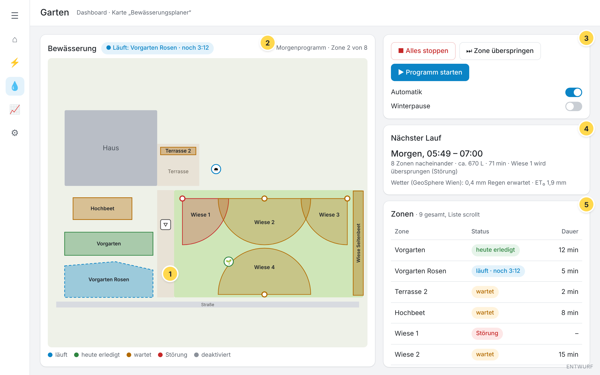
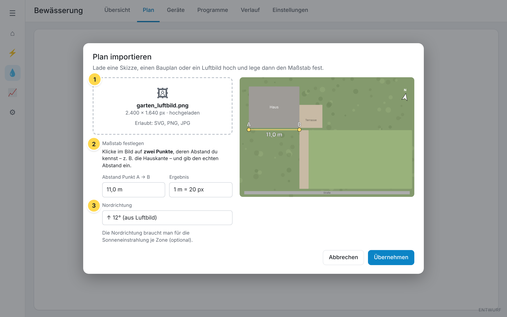
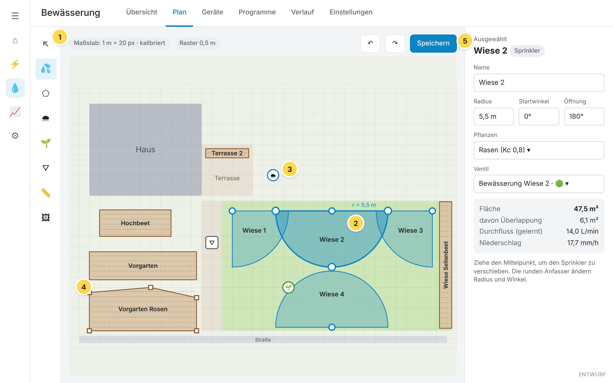
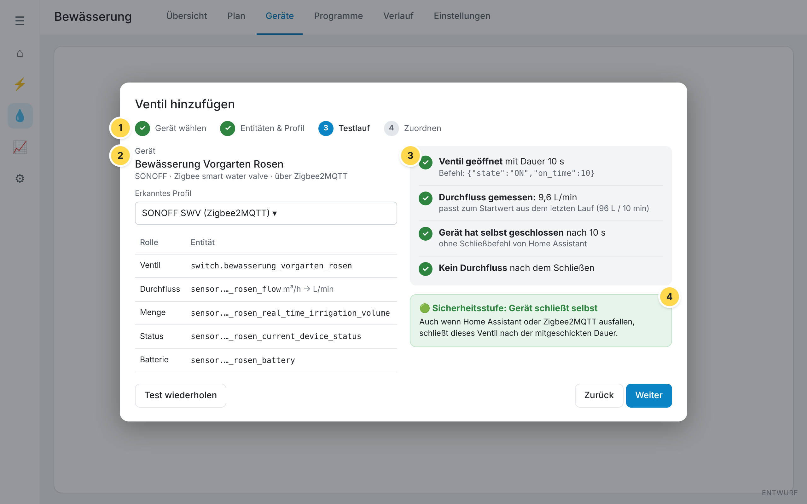
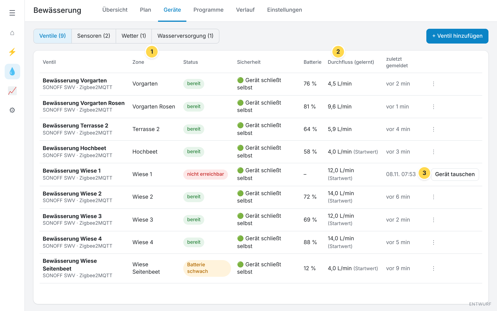
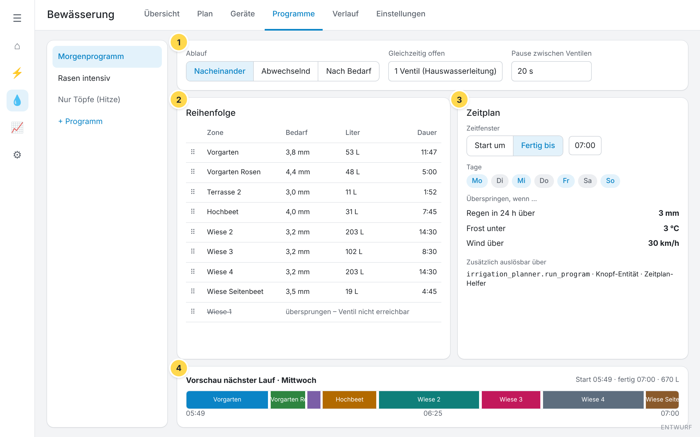
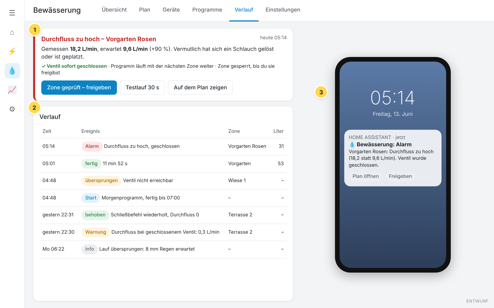
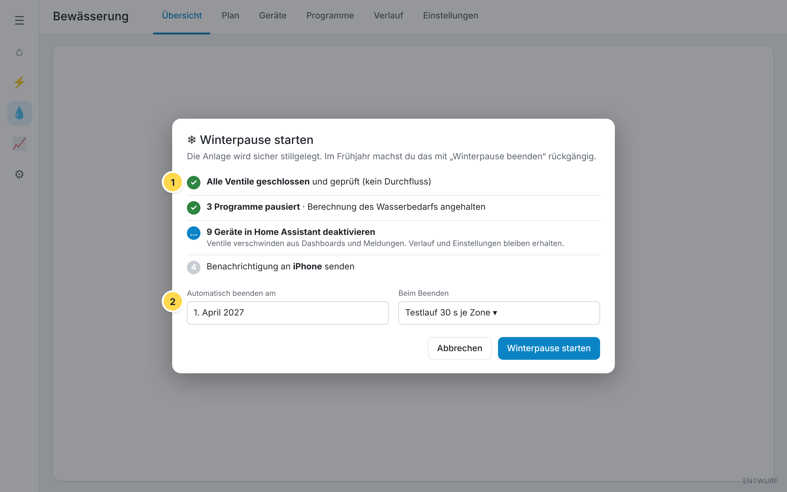

# Bewässerungsplaner – Benutzerhandbuch

> **Entwurf.** Die Erweiterung ist noch nicht gebaut. Dieses Handbuch beschreibt die geplante Bedienung laut [Konzept](KONZEPT.md), und die Bilder sind **Entwürfe** der Oberfläche, keine echten Screenshots.
> Grundlage sind die Daten deiner Anlage (Stand 12.11.2026). Die Durchflüsse von Vorgarten (4,5 L/min), Vorgarten Rosen (9,6 L/min) und Terrasse 2 (5,9 L/min) stammen aus echten Läufen. Die übrigen Werte, Flächen und der Gartenplan sind Beispiele.
> Sobald die Oberfläche existiert, werden die Bilder durch echte Screenshots ersetzt. Die Entwürfe liegen in [`entwuerfe.html`](entwuerfe.html).

Die gelben Nummern in den Bildern gehören zu den nummerierten Erklärungen darunter.

---

## Inhalt

1. [Das Dashboard](#1-das-dashboard)
2. [Den Gartenplan anlegen](#2-den-gartenplan-anlegen)
3. [Zonen zeichnen](#3-zonen-zeichnen)
4. [Ventile hinzufügen](#4-ventile-hinzufügen)
5. [Geräte im Überblick](#5-geräte-im-überblick)
6. [Programme und Zeitplan](#6-programme-und-zeitplan)
7. [Meldungen und Verlauf](#7-meldungen-und-verlauf)
8. [Winterpause](#8-winterpause)
9. [Wie die Gießdauer berechnet wird](#9-wie-die-gießdauer-berechnet-wird)
10. [Sicherheit: Was passiert, wenn etwas ausfällt?](#10-sicherheit-was-passiert-wenn-etwas-ausfällt)
11. [Häufige Fragen](#11-häufige-fragen)

---

## 1. Das Dashboard

Die Karte **„Bewässerungsplaner“** legst du in ein beliebiges Dashboard. Für den Alltag ist sie alles, was du brauchst.

1. **Gartenplan mit Live-Status.** Jede Zone hat die Farbe ihres Zustands:
   - 🔵 **läuft** (gestrichelter, bewegter Rand)
   - 🟢 **heute erledigt**
   - 🟠 **wartet**
   - 🔴 **Störung**
   - ⚪ **deaktiviert**

   Tippst du auf eine Zone, öffnen sich die Details, und du kannst sie von Hand starten.
2. **Was gerade läuft:** aktive Zone, Restzeit und Fortschritt im Programm („Zone 2 von 8“).
3. **Bedienung:**
   - **Alles stoppen** schließt sofort alle Ventile.
   - **Zone überspringen** beendet die laufende Zone und macht mit der nächsten weiter.
   - **Programm starten** startet das Standardprogramm.
   - **Automatik** schaltet die Zeitpläne ein oder aus.
   - **Winterpause** siehe [Kapitel 8](#8-winterpause).
4. **Nächster Lauf:** Startzeit, Anzahl der Zonen, geschätzte Liter und Dauer, dazu die Wetterlage, die in die Berechnung einfließt.
5. **Zonenliste:** Status und geplante Dauer jeder Zone.

> 💡 Auch ein manueller Start schickt dem Ventil **immer eine Dauer** mit. Ein Ventil, das „einfach offen“ ist, gibt es in diesem System nicht.

---

## 2. Den Gartenplan anlegen

Die Verwaltung findest du in der Seitenleiste unter **💧 Bewässerung**, Reiter **Plan**. Dort klickst du auf **🖼 Plan importieren**.

1. **Bild hochladen:** SVG, PNG oder JPG. Das kann sein:
   - eine Skizze oder ein Bauplan
   - ein **Luftbild**, z. B. ein Screenshot aus einem Kartendienst. Beachte dabei die Nutzungsbedingungen des Dienstes.
2. **Maßstab festlegen:** Klicke im Bild auf zwei Punkte, deren Abstand du kennst, z. B. Anfang und Ende einer Hauswand. Gib dann den echten Abstand ein. Im Beispiel sind es 11,0 m, daraus ergibt sich **1 m = 20 px**.
   Der Maßstab ist entscheidend: Alle Flächen und damit alle Literangaben hängen davon ab. Miss lieber eine lange Strecke als eine kurze.
3. **Nordrichtung** (optional). Sie wird für die Sonneneinstrahlung je Zone verwendet.

Hast du kein Bild, kannst du auch auf einem leeren Raster zeichnen.

---

## 3. Zonen zeichnen

1. **Werkzeugleiste** (von oben nach unten):

   | Symbol | Werkzeug | Bedienung |
   |---|---|---|
   | ↖ | Auswählen | Objekte anklicken, verschieben, löschen |
   | 💦 | **Sprinkler** | Mittelpunkt setzen, dann Radius aufziehen, dann den Winkel ziehen |
   | ⬠ | **Tropfbereich** | Eckpunkte des Beets anklicken, Doppelklick schließt das Polygon |
   | 🌧 | Regensensor | an der Position des Sensors absetzen |
   | 🌱 | Bodenfeuchtesensor | absetzen und einer Zone zuordnen |
   | ⛛ | Ventil / Verteiler | Position der Ventile, als Orientierungshilfe |
   | 📏 | Maßstab | neu kalibrieren |
   | 🖼 | Plan importieren | Hintergrundbild tauschen |

2. **Sprinkler bearbeiten:** Der Mittelpunkt verschiebt den Sprinkler. Die runden Anfasser am Rand ändern **Radius** und **Öffnungswinkel**. So bildest du Kreis-, Halbkreis- und Viertelkreisregner ab.
3. **Sensoren** werden als Symbol auf dem Plan angezeigt. Ein Bodenfeuchtesensor korrigiert den Wasserbedarf der Zonen, denen er zugeordnet ist.
4. **Tropfbereiche** sind Polygone. Die eckigen Anfasser sind die Eckpunkte. Klickst du auf eine Kante, entsteht ein neuer Punkt.
5. **Eigenschaften** des gewählten Objekts:
   - **Name**, **Radius / Start- / Öffnungswinkel** (bei Sprinklern)
   - **Pflanzen:** Rasen, Beet, Hochbeet, Rosen, Töpfe … Daraus ergibt sich der Pflanzenfaktor *Kc*, also wie durstig die Pflanzen sind.
   - **Ventil**, das diese Zone versorgt. Die Sicherheitsstufe 🟢/🟡 steht dabei.
   - **Fläche**, berechnet aus der Zeichnung, **Überlappung** mit anderen Sprinklern, **gelernter Durchfluss** und **Niederschlag** in mm/h

> 💡 Überlappende Sprinkler sind normal. Die doppelt bewässerte Fläche wird in der Berechnung berücksichtigt.

---

## 4. Ventile hinzufügen

Reiter **Geräte**, dann **+ Ventil hinzufügen**. Ein Assistent führt dich in vier Schritten durch.

1. **Die vier Schritte:**
   - Gerät wählen
   - Entitäten und Profil prüfen
   - Testlauf
   - Zone zuordnen
2. **Gerät und Profil:** Du wählst ein Gerät aus Home Assistant. Der Assistent **erkennt automatisch**, welche Entität das Ventil ist, welche den Durchfluss misst und welche Status und Batterie meldet. Außerdem schlägt er ein **Geräteprofil** vor, im Beispiel „SONOFF SWV (Zigbee2MQTT)“. Du kannst alles von Hand ändern.
   Das funktioniert mit **jeder Hardware**, die in Home Assistant ein Ventil oder einen Schalter liefert. Für unbekannte Geräte legst du ein eigenes Profil an.
3. **Testlauf:** Das Ventil öffnet **10 Sekunden**. Dabei wird geprüft:
   - Öffnet das Ventil?
   - Wie hoch ist der Durchfluss?
   - **Schließt das Gerät von selbst**, ohne Schließbefehl von Home Assistant?
   - Fließt danach wirklich nichts mehr?
4. **Ergebnis: die Sicherheitsstufe.**
   - 🟢 **Gerät schließt selbst:** Auch wenn Home Assistant abstürzt oder das Funknetz ausfällt, geht das Ventil nach der geplanten Zeit zu.
   - 🟡 **Nur Home Assistant überwacht die Zeit:** Das funktioniert, aber bei einem Ausfall kann das Ventil offen bleiben. Für dauerhaften Betrieb ist ein Gerät mit eigenem Timer empfohlen.

Im letzten Schritt ordnest du das Ventil einer **Zone** und der **Wasserversorgung** zu und setzt es auf Wunsch auf den Plan.

> ⚠️ Für den Testlauf muss Wasser anliegen. Stell sicher, dass niemand gerade im Sprühbereich steht.

---

## 5. Geräte im Überblick

Der Reiter **Geräte** zeigt alle zugeordneten Ventile, Sensoren, Wetterquellen und die Wasserversorgung.

1. **Zone und Status** jedes Ventils:
   - **bereit**
   - **nicht erreichbar:** Das Gerät meldet sich nicht.
   - **Batterie schwach:** Die Warnschwelle ist einstellbar.

   Ventile mit Störung werden in Programmen **automatisch übersprungen**, und du bekommst eine Meldung.
2. **Sicherheitsstufe und gelernter Durchfluss.** Der Durchfluss wird mit jedem Lauf genauer. Steht „(Startwert)“ dabei, gab es noch keinen echten Lauf.
3. **Gerät tauschen:** Wenn du ein Ventil neu anlernst oder durch ein anderes ersetzt, wählst du hier einfach das neue Gerät aus. **Zone, Verlauf und gelernte Werte bleiben erhalten.**
   Im Beispiel ist „Wiese 1“ nicht erreichbar, so wie im Winter, wenn die Batterien herausgenommen sind. Während der Winterpause werden solche Ventile nicht als Störung gemeldet.

Über die Leiste oben wechselst du zu **Sensoren**, **Wetter** und **Wasserversorgung**. Bei der Wasserversorgung stellst du ein, **wie viele Ventile gleichzeitig offen sein dürfen**. Für deine Hauswasserleitung ist das **1**.

---

## 6. Programme und Zeitplan

Ein **Programm** legt fest, welche Zonen in welcher Reihenfolge wann laufen. Du kannst mehrere anlegen, z. B. „Morgenprogramm“, „Rasen intensiv“ oder „Nur Töpfe (Hitze)“.

1. **Ablauf:**
   - **Nacheinander:** Zone für Zone, jede komplett.
   - **Abwechselnd:** Alle Zonen bekommen reihum kurze Gießphasen (z. B. 5 min), bis jede ihre Menge hat. Auf Rasen und schwerem Boden zieht das Wasser so besser ein und läuft weniger ab.
   - **Nach Bedarf:** Die durstigsten Zonen kommen zuerst. Reicht das Zeitfenster nicht, fallen Zonen mit niedriger Priorität weg.

   Außerdem stellst du ein, **wie viele Ventile gleichzeitig offen sein dürfen** (Standard 1) und wie lange die **Pause zwischen zwei Ventilen** ist, damit sich der Leitungsdruck erholt.
2. **Reihenfolge:** Die Zonen ziehst du am Griff ⠿ in die gewünschte Reihenfolge. Für jede Zone siehst du den berechneten Bedarf in mm, die Liter und die Dauer. Gestörte Zonen sind durchgestrichen und werden übersprungen.
3. **Zeitplan:**
   - **Start um** einer festen Uhrzeit, oder **Fertig bis**. Dann rechnet das System die Startzeit selbst aus.
   - **Tage**
   - **Überspringen** bei Regen, Frost oder Wind; die Grenzwerte stellst du selbst ein.
   - Programme lassen sich **zusätzlich** über Automationen, einen Knopf oder einen Zeitplan-Helfer von Home Assistant starten.
4. **Vorschau** des nächsten Laufs als Zeitleiste: welche Zone wann läuft, die Pausen dazwischen, Start, Ende und Gesamtliter. Wird ein Lauf übersprungen, steht hier der Grund, z. B. „8 mm Regen erwartet“.

---

## 7. Meldungen und Verlauf

1. **Alarme** stehen oben im Reiter **Verlauf**, mit Ursache, Messwerten und dem, was das System bereits getan hat. Im Beispiel:
   - Der Durchfluss war fast doppelt so hoch wie gelernt, ein Schlauch ist vermutlich lose.
   - **Das Ventil wurde sofort geschlossen.**
   - Die Zone bleibt gesperrt, bis du sie nach der Kontrolle mit **„Zone geprüft – freigeben“** wieder freigibst.
2. **Verlauf** aller Läufe, Überspringungen, Warnungen und Alarme, mit den verbrauchten Litern.
3. **Push-Nachricht** auf dein Handy über die Home-Assistant-App, mit Schnellaktionen.

**Diese Situationen erkennt das System:**

| Situation | wahrscheinliche Ursache | Reaktion |
|---|---|---|
| Durchfluss **viel höher** als gelernt | Schlauch gelöst oder geplatzt | Ventil zu, Alarm, Zone gesperrt |
| Durchfluss **viel niedriger** als gelernt | Knick, Verstopfung, wenig Druck | Warnung, bei Unterschreiten des Grenzwerts Ventil zu |
| **kein Durchfluss** / Wassermangel | Hahn zu, kein Wasser | Ventil zu, Alarm |
| Durchfluss bei **geschlossenem** Ventil | Ventil dichtet nicht ab | OFF-Befehl wiederholen, Warnung |
| Gerät meldet **Leck** | Gerätemeldung | Ventil zu, Alarm |
| zwei Ventile gleichzeitig offen | manuell geöffnet oder Fehler | das spätere schließen, Warnung |

> ⚠️ **Grenze der Überwachung:** Die Durchflussmesser sitzen in den Ventilen. Ein Leck **vor** den Ventilen, z. B. zwischen Wasserhahn und Verteiler, können sie nicht erkennen. Dafür bräuchtest du einen Wasserzähler in der Zuleitung. Er lässt sich unter Geräte → Wasserversorgung ergänzen.

---

## 8. Winterpause

Den Schalter **Winterpause** findest du im Dashboard oder im Reiter Übersicht.

1. **Was beim Einwintern passiert**, Schritt für Schritt mit Häkchen:
   1. Alle Ventile werden geschlossen und geprüft.
   2. Alle Programme werden pausiert, und die Bedarfsberechnung hält an. So sammelt sich über den Winter kein Wasserdefizit an.
   3. Die **zugeordneten Geräte werden in Home Assistant deaktiviert**. Sie verschwinden aus Dashboards und Meldungen, aber Verlauf und Einstellungen bleiben erhalten.
   4. Du bekommst eine Benachrichtigung.
2. **Automatisch beenden** an einem Datum, z. B. 1. April. Beim Beenden werden die Geräte wieder aktiviert. Das System wartet, bis sich alle Ventile melden, und macht auf Wunsch einen **kurzen Testlauf je Zone** mit Prüfung des Durchflusses.

> 💡 Die Ventile vor dem Frost abbauen bzw. entleeren musst du weiterhin selbst. Die Winterpause sorgt nur dafür, dass Home Assistant während dieser Zeit nichts tut und keine Fehlalarme meldet.

---

## 9. Wie die Gießdauer berechnet wird

Du musst nichts davon selbst rechnen. Es hilft aber zu verstehen, woher die Zahlen kommen.

1. **Fläche:** aus der Zeichnung. Bei Sprinklern ist das ein Kreissegment, z. B. ein Halbkreis mit 5,5 m Radius = 47,5 m². Bei Beeten ist es das Polygon.
2. **Wasserbedarf in mm:**
   - Aus Temperatur, Luftfeuchte, Wind und Sonne rechnet das System die **Verdunstung** (ET₀). Die Daten kommen z. B. von GeoSphere Austria.
   - Diese wird mit dem **Pflanzenfaktor** multipliziert, z. B. Rasen 0,8.
   - Abgezogen wird der **Regen**, der gefallen ist bzw. vorhergesagt wird.
   - Ein **Bodenfeuchtesensor**, wenn vorhanden, korrigiert das Ergebnis.
3. **Liter:** 1 mm auf 1 m² sind 1 Liter. Weil nicht jeder Tropfen ankommt, wird durch die Effizienz geteilt: Tropfschlauch etwa 90 %, Sprinkler etwa 75 %.
4. **Dauer:** Liter geteilt durch den **gelernten Durchfluss** des Ventils.

**Beispiel „Vorgarten“:** 12,6 m² Tropfbereich, Bedarf 3,8 mm
→ 3,8 × 12,6 / 0,9 ≈ **53 L**
→ bei 4,5 L/min ≈ **11 min 47 s**

---

## 10. Sicherheit: Was passiert, wenn etwas ausfällt?

| Ausfall | Ventil mit 🟢 | Ventil mit 🟡 |
|---|---|---|
| Home Assistant stürzt ab oder startet neu | schließt nach der geplanten Zeit von selbst | kann offen bleiben, bis Home Assistant wieder läuft; beim Start werden alle Ventile geschlossen |
| Zigbee2MQTT oder Funk fällt aus | schließt von selbst | kann offen bleiben |
| Schließbefehl geht verloren | nicht nötig, das Gerät schließt selbst; der OFF-Befehl wird trotzdem wiederholt | OFF wird wiederholt, bis das Ventil als geschlossen gemeldet wird |
| Zu langer Lauf durch Rechenfehler | begrenzt durch die **Höchstdauer je Zone** | ebenso |

Zusätzlich gilt:
- Vor jedem Start wird geprüft, ob die Funkverbindung steht und die Batterie reicht.
- Die Funktion des Ventils „automatisch schließen bei Wassermangel“ bleibt eingeschaltet.

---

## 11. Häufige Fragen

**Kann ich eine Zone einfach mal so gießen?**
Ja. Tippe im Dashboard auf die Zone und wähle „Jetzt gießen“ mit einer Dauer. Läuft gerade etwas, wird die Zone hinten angereiht.

**Ich habe neue Ventile von einem anderen Hersteller. Geht das?**
Ja. Füge sie mit dem Assistenten hinzu. Gibt es kein passendes Profil, nimmt der Assistent die allgemeine Steuerung (🟡) oder du legst ein Profil an. Der Testlauf zeigt dir, welche Sicherheitsstufe das Gerät erreicht.

**Warum wird eine Zone übersprungen?**
Im Verlauf steht der Grund: Regen erwartet, Frost, Ventil nicht erreichbar, Zone nach einem Alarm gesperrt oder Zeitfenster zu kurz (im Modus „Nach Bedarf“).

**Brauche ich Smart Irrigation noch?**
Für den Umstieg kann der Bewässerungsplaner die Werte von Smart Irrigation übernehmen. Später rechnet er selbst, und Smart Irrigation kann deinstalliert werden.

**Was passiert mit meinen alten Bewässerungsskripten?**
Sie sind im privaten Haus-Repo unter `ha_backup/scripts/` gesichert. Nach der Umstellung werden sie deaktiviert und später gelöscht.
